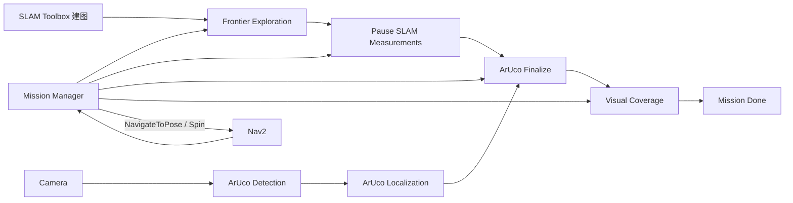

# METR4202 2026 Team 13

ROS 2 Humble mobile-robot system for autonomous mapping, frontier exploration, ArUco marker localization, and camera-oriented boundary coverage.

本仓库只包含 Team 13 自研软件。TurtleBot3、Gazebo、SLAM Toolbox、Nav2 和相机驱动作为外部依赖使用。

## 系统流程



任务状态顺序：

```text
WAITING_FOR_SERVICES
  → EXPLORATION
  → SLAM_FREEZE
  → ARUCO_FINALIZE
  → COVERAGE_INIT
  → COVERAGE
  → DONE
```

Exploration 和 Coverage 只生成 `MotionTask`。所有导航与旋转动作由 Mission Manager 统一提交给 Nav2。

## 自研 ROS 2 包

| 包 | 作用 |
|---|---|
| `metr4202_interfaces` | 自定义消息和服务 |
| `metr4202_navigation` | Mission Manager、前沿探索、视觉覆盖和恢复 |
| `metr4202_aruco` | ArUco 检测、相对观测、重投影和融合 |
| `metr4202_bringup` | 仿真及实机总启动、SLAM 配置 |

## 算法概览

### Frontier Exploration

Exploration 从持续更新的 OccupancyGrid 中寻找与未知空间相邻的自由栅格，以 8 邻域形成前沿簇，再从前沿向安全自由空间搜索候选目标。

候选点必须：

- 位于机器人可达的安全连通域；
- 与障碍保持配置的安全距离；
- 不处于 Nav2 到达容差以内；
- 不靠近已经证明无效的历史目标。

当前实现选择最近的有效候选点。到达后会等待地图更新，并用已知栅格增长量判断目标是否有效。

### ArUco Localization

单帧检测使用相机标定、marker 实际边长和四个图像角点，通过 IPPE PnP 估计 marker 在相机坐标系中的位置。

探索期间不会只保存临时 map 坐标，而是保存：

- marker ID；
- marker 在相机坐标系中的三维位置；
- 图像时间戳；
- 对应时刻的 `odom → camera` 位姿；
- 测量方差。

探索完成后，系统取得最终 `map → odom`，将所有历史观测重新转换到最终 map，执行按 ID 的中位数/MAD 离群过滤，再按时间顺序进行独立 Kalman 融合。

Coverage 阶段保留探索阶段结果，并使用固定的最终变换继续融合新观测。正常阶段切换不会调用 `/aruco/reset_map`。

### Visual Coverage

Coverage 初始化时冻结最终地图。算法提取自由与占用区域边界，将其离散为带表面法向的目标，并在安全可达空间生成候选观测点。

理论可见性同时检查：

- 相机到目标的距离；
- 相对目标表面法向的入射角；
- supercover 栅格射线遮挡；
- 候选点安全性和可达性。

候选评分为：

```text
score = visible_uncovered_targets / (travel_distance + fixed_visit_cost)
```

选中候选后先执行 `NAVIGATE`，成功后执行一次 360° `SPIN`。只有旋转成功才提交该候选对应的覆盖结果。

### Recovery

Recovery 接口支持重试、跳过和终止决策。当前实现是占位版本，只返回 `SKIP`，尚未实现后退、清障或重新定位。

## 环境要求

已针对以下环境设计：

- Ubuntu 22.04
- ROS 2 Humble
- Gazebo Classic 11
- Nav2
- SLAM Toolbox
- TurtleBot3
- Python 3、NumPy、OpenCV 和 ROS 2 Python API

仿真完整 ArUco 功能建议使用带相机的 `waffle_pi`。

## 安装

将整个仓库放入 ROS 2 工作区的 `src` 目录：

```bash
mkdir -p ~/turtlebot3_ws/src
cd ~/turtlebot3_ws/src
git clone git@github.com:lingxu-guo/metr4202_2026_team13.git
cd ..
```

安装依赖并构建：

```bash
source /opt/ros/humble/setup.bash
rosdep install --from-paths src --ignore-src -r -y
colcon build --symlink-install
source install/setup.bash
```

不要复制其他工作区的 `build/`、`install/` 或 `log/` 目录。

## 测试

```bash
cd ~/turtlebot3_ws
source /opt/ros/humble/setup.bash
source install/setup.bash

colcon test --packages-select \
  metr4202_interfaces \
  metr4202_aruco \
  metr4202_navigation \
  metr4202_bringup

colcon test-result --verbose
```

当前版本已完成四个包的构建验证，并通过 33 项测试：0 errors、0 failures、3 skipped。

## 启动仿真

如果从 Windows 使用 WSL：

```powershell
wsl -d Ubuntu-22.04
```

在 Ubuntu 终端中：

```bash
cd ~/turtlebot3_ws
source /opt/ros/humble/setup.bash
source install/setup.bash
export TURTLEBOT3_MODEL=waffle_pi

ros2 launch metr4202_bringup simulation.launch.py
```

只启动 Gazebo、SLAM、Nav2 和 RViz，不启动自研任务节点：

```bash
ros2 launch metr4202_bringup simulation.launch.py start_team13:=false
```

### 启动其他地图

`simulation.launch.py` 的 `world` 参数接受任意 Gazebo Classic `.world`
文件的绝对路径。可以同时用 `x_pose` 和 `y_pose` 设置机器人出生点：

```bash
ros2 launch metr4202_bringup simulation.launch.py \
  world:=/absolute/path/to/team13_arena.world \
  x_pose:=0.0 \
  y_pose:=0.0
```

例如启动 TurtleBot3 自带的空地图：

```bash
ros2 launch metr4202_bringup simulation.launch.py \
  world:="$(ros2 pkg prefix --share turtlebot3_gazebo)/worlds/empty_world.world" \
  x_pose:=0.0 \
  y_pose:=0.0
```

其他可直接替换的 TurtleBot3 地图包括：

```text
turtlebot3_world.world
turtlebot3_house.world
turtlebot3_dqn_stage1.world
turtlebot3_dqn_stage2.world
turtlebot3_dqn_stage3.world
turtlebot3_dqn_stage4.world
```

例如启动 TurtleBot3 House：

```bash
ros2 launch metr4202_bringup simulation.launch.py \
  world:="$(ros2 pkg prefix --share turtlebot3_gazebo)/worlds/turtlebot3_house.world" \
  x_pose:=-2.0 \
  y_pose:=-0.5
```

### 启动 METR4202 Final Demo World

Final Demo World 的 ArUco marker 使用单独的 Gazebo 材质和模型目录。启动前必须
声明 `GAZEBO_RESOURCE_PATH` 和 `GAZEBO_MODEL_PATH`；否则 marker 贴图可能无法显示。

含 ArUco marker 的完整启动命令：

```bash
cd ~/turtlebot3_ws
source /opt/ros/humble/setup.bash
source install/setup.bash
export TURTLEBOT3_MODEL=waffle_pi

export GAZEBO_RESOURCE_PATH="$(ros2 pkg prefix --share metr4202_aruco_explore)/resource:${GAZEBO_RESOURCE_PATH:-/usr/share/gazebo-11}"
export GAZEBO_MODEL_PATH="$(ros2 pkg prefix --share metr4202_aruco_explore)/models:${GAZEBO_MODEL_PATH:-}"

ros2 launch metr4202_bringup simulation.launch.py \
  world:="$(ros2 pkg prefix --share metr4202_aruco_explore)/worlds/metr4202_final_demo.world" \
  x_pose:=0.0 \
  y_pose:=0.0
```

启动不含 ArUco marker 的版本时，只需替换 world 文件：

```bash
ros2 launch metr4202_bringup simulation.launch.py \
  world:="$(ros2 pkg prefix --share metr4202_aruco_explore)/worlds/metr4202_final_demo_no_aruco.world" \
  x_pose:=0.0 \
  y_pose:=0.0
```

如果 `ros2 pkg prefix --share metr4202_aruco_explore` 找不到包，请先在当前工作区
构建该依赖并重新加载环境：

```bash
colcon build --symlink-install --packages-select metr4202_aruco_explore
source install/setup.bash
```

使用不同 DDS Domain：

```bash
ros2 launch metr4202_bringup simulation.launch.py ros_domain_id:=13
```

## 启动实机

```bash
cd ~/turtlebot3_ws
source /opt/ros/humble/setup.bash
source install/setup.bash
export TURTLEBOT3_MODEL=waffle_pi

ros2 launch metr4202_bringup real_robot.launch.py
```

启动前必须确认：

- TurtleBot3 型号和 LDS 型号正确；
- 相机正在发布图像与 CameraInfo；
- TF 树包含 `map`、`odom`、`base_footprint` 和相机 optical frame；
- Nav2、SLAM 与机器人使用相同的 `ROS_DOMAIN_ID`。

## 配置入口

| 文件 | 主要内容 |
|---|---|
| `metr4202_navigation/config/navigation.yaml` | Exploration 和 Coverage 参数 |
| `metr4202_aruco/config/aruco.yaml` | ArUco 检测、相对观测及融合参数 |
| `metr4202_bringup/config/slam_toolbox.yaml` | SLAM Toolbox 参数 |
| `metr4202_bringup/launch/simulation.launch.py` | 仿真世界、出生点、GUI、频率和配置文件 |
| `metr4202_bringup/launch/real_robot.launch.py` | 机器人硬件、相机、Domain ID 和配置文件 |

查看全部 launch 参数：

```bash
ros2 launch metr4202_bringup simulation.launch.py --show-args
ros2 launch metr4202_bringup real_robot.launch.py --show-args
ros2 launch metr4202_navigation team13_system.launch.py --show-args
```

需要在最终硬件上重点确认：

- Coverage 的机器人半径、相机径向偏移、水平 FOV、观察距离和最大入射角；
- ArUco 的 marker 实际边长、字典、深度范围和重投影误差；
- 相机 `CameraInfo.K/D`；
- `odom → camera` 外参和图像时间戳 TF；
- 探索结束时可用的最终 `map → odom`。

## 主要接口

| 类型 | 名称 | 作用 |
|---|---|---|
| Service | `/exploration/get_next_task` | 请求下一探索任务 |
| Service | `/coverage/get_next_task` | 初始化 Coverage 或请求下一任务 |
| Service | `/aruco/finalize_exploration` | 使用最终地图重算探索观测 |
| Service | `/aruco/reset_map` | 人工清空 ArUco 历史及融合结果 |
| Service | `/aruco/get_marker_map` | 查询融合后的 marker 地图 |
| Topic | `/aruco/detections` | 图像角点和 marker ID |
| Topic | `/aruco/marker_map` | 融合后的 marker 地图 |
| Topic | `/coverage/status_map` | Coverage 目标状态栅格 |
| Action | Nav2 `NavigateToPose` | 执行导航任务 |
| Action | Nav2 `Spin` | 执行原地旋转 |

## 文档

- [初始化、调参与启动说明](STARTUP_GUIDE.md)
- [系统理论与算法说明 中文版](SYSTEM_THEORY_AND_ALGORITHMS_ZH.md)
- [System Theory and Algorithms English](SYSTEM_THEORY_AND_ALGORITHMS_EN.md)
- [算法理论 Word 中文版](docs/METR4202_Team13_Algorithms_ZH.docx)
- [Algorithm Theory Word English](docs/METR4202_Team13_Algorithms_EN.docx)

## 已知限制

- Recovery 当前只跳过失败任务。
- Exploration 当前以最近有效前沿为主，不是完整的全局收益优化。
- Coverage 使用二维地图和理论相机几何，不直接验证目标是否出现在图像中。
- Coverage 不建模相机高度、俯仰、垂直视场或三维遮挡。
- ArUco 精度依赖正确的相机标定、外参、SLAM 最终一致性和多样化观察视角。
