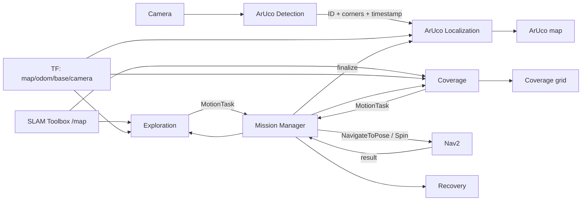
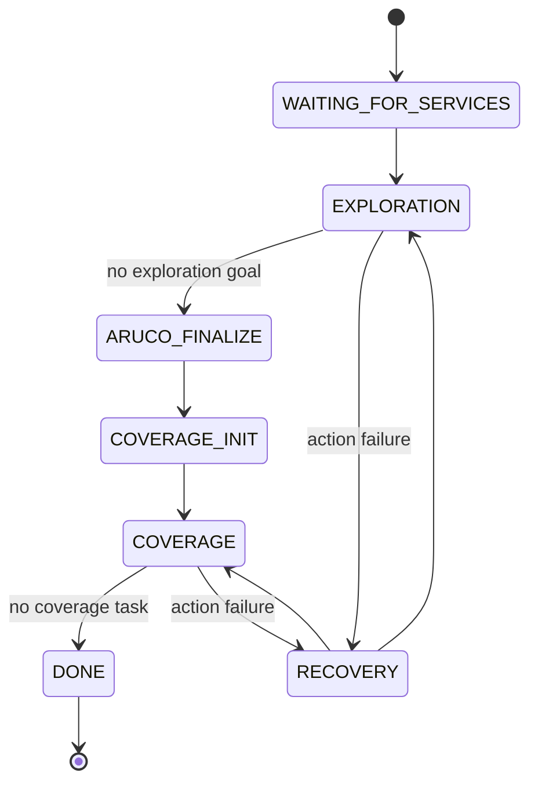

# METR4202 Team 13 System Theory and Algorithms

## 1. Scope and Objective

This document covers only the current `metr4202_2026_team13` implementation. TurtleBot3, Gazebo, SLAM Toolbox, Nav2, and camera drivers are external dependencies.

The mission sequence is mapping and exploration → final ArUco recomputation → visual coverage on a frozen map. Nav2 executes motion; Mission Manager controls phases and results.

## 2. Overall System Structure

| Package | Responsibility |
|---|---|
| `metr4202_interfaces` | Custom messages and service contracts |
| `metr4202_bringup` | Simulation/robot, SLAM, Nav2, and custom-node startup |
| `metr4202_navigation` | Mission Manager, Exploration, Coverage, and Recovery |
| `metr4202_aruco` | Image detection, relative observations, reprojection, and fusion |





## 3. Interface Layer

### Theory

The interface layer separates task generation from motion execution. Exploration and Coverage return abstract tasks; Mission Manager submits them to Nav2. Planning, orchestration, and execution can therefore be tested independently.

### Current algorithm and data

- `MotionTask` represents `NAVIGATE` or `SPIN` and carries a task ID.
- `Exploration.srv` returns the next exploration task or completion.
- `Coverage.srv` supports initialization, next-task requests, and previous-result feedback.
- `Recovery.srv` returns retry, skip, or abort.
- ArUco messages carry corner detections and the fused marker map; `GetArucoMap.srv` provides queries.

## 4. Bringup and External Components

### Theory

SLAM Toolbox maintains the map and `map→odom`; Nav2 performs planning, avoidance, and base control. The custom packages focus on mission decisions and visual localization instead of duplicating low-level navigation.

### Current algorithm

- Simulation starts the Gazebo world, robot, SLAM, Nav2, and all custom nodes.
- Real-robot launch starts the robot/camera stack, SLAM, Nav2, and custom nodes.
- `team13_system.launch.py` starts navigation and ArUco nodes and loads YAML configuration.
- Paths are resolved from ROS package share directories, not developer-specific paths, so the source can be copied to another ROS 2 workspace and rebuilt.

## 5. Exploration

### Theory

A frontier is the boundary between known free and unknown space. Moving near it exposes new sensor information. A valid goal must also be safe, free, and connected to the robot.

### Current algorithm

1. Continuously read `/map` and obtain the robot pose from TF.
2. Mark free cells adjacent to unknown cells as frontiers.
3. Form 8-connected clusters and reject small clusters.
4. Search from each frontier into safely cleared free space for a goal.
5. Reject unreachable, too-close, unsafe, or recently ineffective candidates.
6. Select the nearest valid candidate, orient it toward the frontier, and return `NAVIGATE`.
7. After navigation, wait for map updates and measure known-cell growth. Suppress goals with insufficient gain.
8. Finish when no valid candidate remains.

Selection is currently distance-led. Declared `information_gain_weight`, `distance_weight`, and `bootstrap_spin_yaw` parameters are not used in the current decision.

## 6. ArUco Detection

### Theory

ArUco markers are dictionary-coded square patterns. The detector locates quadrilaterals and decodes their IDs. This layer emits image measurements without assigning map coordinates.

### Current algorithm

1. Convert ROS images to OpenCV images.
2. Select the configured dictionary and detector settings.
3. Detect marker IDs and four pixel corners.
4. Publish results with the original timestamp and camera frame.
5. Optionally publish an annotated debug image.

## 7. ArUco Localization

### Theory

SLAM may change `map→odom` during exploration after loop closure or graph optimization. Saving only the current map coordinate would preserve early map errors. The implementation stores relative observations and reprojects all of them using the final transform.

```text
marker(camera)
  → marker(odom, using odom→camera at observation time)
  → marker(final map, using final map→odom)
```

### Current algorithm

Per-frame processing:

1. Use camera intrinsics, distortion, physical marker size, and corners in square IPPE/PnP.
2. Reject non-positive depth, excessive range, or excessive reprojection error.
3. Estimate three-axis measurement variance from range and pixel error.

Each exploration observation stores the marker ID, its camera-frame 3D position, image timestamp, matching `odom→camera` translation/rotation, and measurement variance.

At exploration completion:

1. Mission Manager calls `/aruco/finalize_exploration`.
2. Localization obtains and freezes the latest `map→odom`.
3. All historical observations are reprojected to the final map.
4. Per-ID median, MAD, and noise-floor filtering removes batch outliers.
5. Accepted observations enter each marker's independent statistical/Kalman fusion state in timestamp order.
6. Results are retained; the phase change does not reset the map.

Coverage observations use the frozen final `map→odom` and continue in the same fusion states. Fusion rejects excessive innovations, suppresses highly correlated viewpoints, and confirms a marker only after enough independent observations. `/aruco/reset_map` is manual only.

## 8. Coverage

### Theory

Coverage means theoretical camera visibility of environmental boundaries, not floor cleaning. Visibility depends on range, surface incidence angle, occlusion, and robot reachability.

### Current algorithm

Map model:

1. Copy the final OccupancyGrid during initialization and freeze it.
2. Classify free, occupied, and unknown cells. Unknown space is neither traversable nor transparent.
3. Inflate obstacles using robot radius, radial camera offset, and clearance.
4. Compute the robot's reachable safe component.

Targets and candidates:

1. Extract free/occupied contours, with a cell-face boundary fallback.
2. Discretize boundaries into targets with surface normals.
3. Generate coarse-to-fine candidate positions in reachable safe space.
4. Compute theoretical visibility using range, maximum incidence angle, supercover-ray occlusion, and reachability.
5. Mark targets seen by no candidate as uncoverable.

Execution transaction:

1. Candidate gain is its number of visible uncovered targets.
2. Rank using `newly covered targets / (travel distance + fixed visit cost)`.
3. Return `NAVIGATE`, then a 360° `SPIN` for the same candidate after navigation succeeds.
4. Mark targets covered only after a successful spin; failed navigation never triggers that spin.
5. Remove failed candidates and re-evaluate runtime-uncoverable targets.
6. Publish a grid distinguishing uncovered, covered, and uncoverable targets.

## 9. Mission Manager

### Theory

Mission Manager is the sequential controller. It establishes transaction boundaries for phases, services, and action results without calculating frontiers, coverage sets, or marker coordinates.

### Current algorithm

- Wait for custom services and the Nav2 lifecycle to become active.
- Request Exploration/Coverage tasks and submit them to Nav2.
- Finalize ArUco observations before initializing Coverage.
- Include the preceding action result in Coverage requests.
- Map `NAVIGATE` to `NavigateToPose` and `SPIN` to Nav2 `Spin`.
- Send rejected, cancelled, or failed actions to Recovery.
- Use task IDs and pending flags to reject stale results and duplicate requests.

## 10. Recovery

### Theory

Recovery converts motion failures into retry, alternate-goal, escape, or abort policies, keeping Nav2 error details out of planning nodes.

### Current algorithm

The current node logs the reason and always returns `SKIP`. It keeps the mission moving but is not active recovery and is a clear future extension point.

## 11. Key Frames and Boundaries

| Frame/data | Role |
|---|---|
| `camera` | Frame of one relative ArUco measurement |
| `base` | Robot body and motion-goal reference |
| `odom` | Continuous local frame retaining stable historical relationships |
| `map` | Global SLAM frame; its final relation is used by ArUco and Coverage |
| `/map` | Continuous for Exploration; copied once by Coverage |
| Nav2 actions | The custom system's only motion-execution interface |

Current limitations:

- Correct TF, camera calibration, physical marker size, and timestamps are required.
- Coverage uses theoretical 2D-map visibility and does not directly verify image appearance.
- Exploration uses the nearest effective frontier rather than global utility optimization.
- Recovery is skip-only.
- ArUco accuracy depends on camera parameters, extrinsics, SLAM consistency, and viewpoint diversity.

Overall loop: **SLAM mapping → frontier exploration → final ArUco reprojection → frozen-map visual coverage → Nav2 execution → result feedback and continued fusion**.
