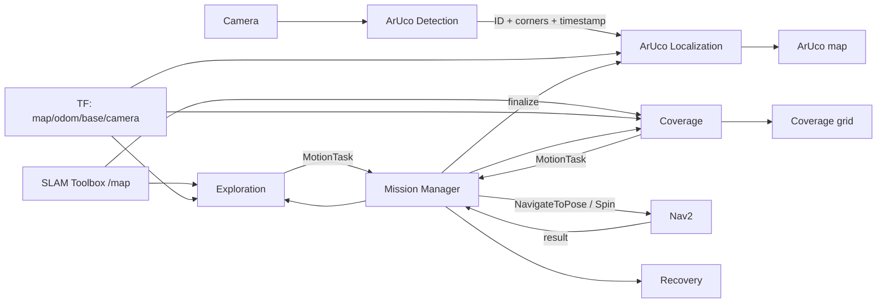
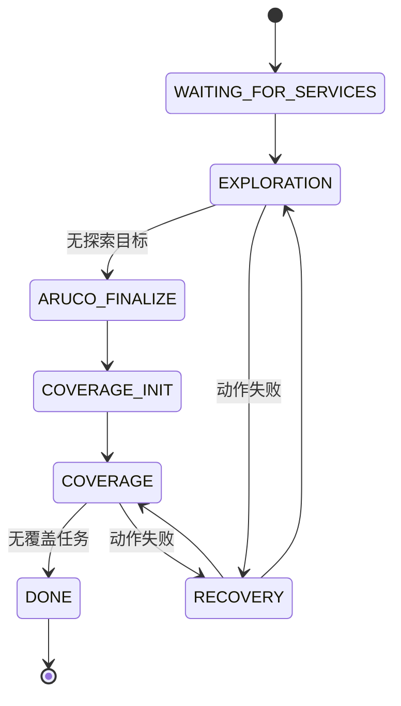

# METR4202 Team 13 系统理论与算法说明

## 1. 范围与目标

本文只描述 `metr4202_2026_team13` 自研包的当前实现。TurtleBot3、Gazebo、SLAM Toolbox、Nav2 和相机驱动仅作为外部依赖。

系统顺序为：建图与探索 → 统一重算 ArUco 地图 → 冻结地图视觉覆盖。Nav2 负责运动执行，Mission Manager 负责阶段和结果管理。

## 2. 系统总体结构

| 软件包 | 职责 |
|---|---|
| `metr4202_interfaces` | 自定义消息与服务契约 |
| `metr4202_bringup` | 仿真/实机、SLAM、Nav2 和自研节点的启动集成 |
| `metr4202_navigation` | Mission Manager、Exploration、Coverage、Recovery |
| `metr4202_aruco` | ArUco 图像检测、相对观测、坐标重投影与融合 |





## 3. 接口层

### 理论说明

接口层将任务生成与运动执行解耦。Exploration/Coverage 只生成抽象任务，Mission Manager 再调用 Nav2，便于单独测试规划、编排和执行。

### 当前算法

- `MotionTask` 表示 `NAVIGATE` 或 `SPIN`，并携带任务 ID。
- `Exploration.srv` 返回下一探索任务或完成状态。
- `Coverage.srv` 支持初始化、下一任务及上一动作结果反馈。
- `Recovery.srv` 返回重试、跳过或终止决定。
- ArUco 消息传递角点检测和融合后的 marker 地图；`GetArucoMap.srv` 提供查询。

## 4. Bringup 与外部组件

### 理论说明

SLAM Toolbox 维护地图和 `map→odom`；Nav2 完成规划、避障与底盘控制。自研包专注任务决策和视觉定位，不重复实现底层导航。

### 当前算法

- 仿真启动 Gazebo 世界、机器人、SLAM、Nav2 及全部自研节点。
- 实机启动机器人/相机相关组件、SLAM、Nav2 及自研节点。
- `team13_system.launch.py` 集中启动导航和 ArUco 节点并加载 YAML。
- 配置通过 ROS 包共享目录定位，不依赖开发机绝对路径，可复制到新 ROS 2 工作区重新构建。

## 5. Exploration

### 理论说明

前沿是已知自由空间与未知空间的交界。机器人到达前沿附近后可获得新信息。目标还必须位于安全自由空间并与机器人连通。

### 当前算法

1. 持续读取 `/map`，用 TF 获取机器人位置。
2. 找出邻接未知单元的自由栅格，组成 frontier。
3. 用 8 邻域聚类并过滤过小簇。
4. 从 frontier 向安全自由空间搜索候选。
5. 过滤不可达、太近、不安全和近期无效的候选。
6. 选择最近候选，使朝向指向 frontier，返回 `NAVIGATE`。
7. 导航后等待地图更新，以已知栅格增长量判断是否有效；增益不足则临时屏蔽。
8. 无有效候选时结束探索。

当前选择主要依据距离；`information_gain_weight`、`distance_weight`、`bootstrap_spin_yaw` 尚未用于实际决策。

## 6. ArUco Detection

### 理论说明

ArUco 是字典编码的方形标记。检测器寻找四边形并解码 ID。检测层只输出图像测量，不绑定地图坐标。

### 当前算法

1. 将 ROS 图像转换为 OpenCV 图像。
2. 按参数选择字典和检测器设置。
3. 检测 marker ID 与四个像素角点。
4. 保留原图时间戳和相机 frame 发布结果。
5. 可选发布带标注的调试图像。

## 7. ArUco Localization

### 理论说明

SLAM 在探索期间可能因回环和图优化改变 `map→odom`。若只保存检测瞬间的 map 坐标，早期 marker 会保留旧地图误差。因此保存相对观测，探索结束后用最终坐标关系统一重投影。

```text
marker(camera)
  → marker(odom，使用观测时刻的 odom→camera)
  → marker(final map，使用最终 map→odom)
```

### 当前算法

单帧处理：

1. 用相机内参、畸变、实际 marker 边长和角点执行方形 IPPE/PnP。
2. 拒绝非正深度、距离超限或重投影误差过大的解。
3. 根据距离与像素误差生成三轴测量方差。

探索阶段保存 marker ID、相机系三维位置、图像时间戳、对应 `odom→camera` 平移/旋转及测量方差。

探索结束时：

1. Mission Manager 调用 `/aruco/finalize_exploration`。
2. 获取并固定最新 `map→odom`。
3. 将全部历史观测重新变换到最终 map。
4. 按 ID 用中位数、MAD 和噪声下限做批量离群过滤。
5. 按时间顺序送入各 marker 独立的统计/Kalman 融合器。
6. 保留融合结果，不执行阶段重置。

Coverage 新观测使用固定的最终 `map→odom`，并在探索结果上继续融合。融合器按创新量拒绝异常值、抑制过于相近的相关视角，获得足够独立观测后才确认 marker。`/aruco/reset_map` 仅供人工重置。

## 8. Coverage

### 理论说明

本项目覆盖的是环境边界的理论相机可见性，不是自由地面清扫。可见性受距离、表面入射角、遮挡与机器人可达性共同约束。

### 当前算法

地图建模：

1. 初始化时复制最终 OccupancyGrid，此后冻结。
2. 区分自由、占用和未知；未知区域不可通行且阻挡视线。
3. 按机器人半径、相机径向偏移和安全余量膨胀障碍。
4. 计算机器人可达的安全连通域。

目标与候选：

1. 提取自由/占用边界轮廓，必要时回退到栅格面边界法。
2. 将边界离散为带表面法向的目标。
3. 在安全可达区按粗到细间距生成候选。
4. 按距离、最大入射角、supercover 射线遮挡和可达性计算理论可见集合。
5. 无候选可见的目标标记为不可覆盖。

任务事务：

1. 候选增益为其可见的未覆盖目标数。
2. 评分为 `新增覆盖数 / (移动距离 + 固定访问代价)`。
3. 先返回 `NAVIGATE`；成功后返回同一候选的 360° `SPIN`。
4. 只有旋转成功才标记目标已覆盖；导航失败不会触发该点旋转。
5. 失败会淘汰候选并重判运行时不可覆盖目标。
6. 发布栅格图区分未覆盖、已覆盖和不可覆盖目标。

## 9. Mission Manager

### 理论说明

Mission Manager 是顺序控制器，为阶段切换、服务调用和动作结果建立事务边界，本身不计算 frontier、覆盖集合或 marker 坐标。

### 当前算法

- 等待自研服务和 Nav2 lifecycle 激活。
- 循环请求 Exploration/Coverage 任务并提交 Nav2。
- 探索完成后先 finalize ArUco，再初始化 Coverage。
- Coverage 请求携带上一动作结果。
- `NAVIGATE` 映射到 `NavigateToPose`，`SPIN` 映射到 Nav2 `Spin`。
- 动作被拒绝、取消或失败时调用 Recovery。
- 用任务 ID 和等待标志拒绝旧结果与重复请求。

## 10. Recovery

### 理论说明

恢复层应将运动失败转换成重试、换目标、脱困或终止策略，使规划节点无需理解所有 Nav2 错误。

### 当前算法

当前节点记录原因并始终返回 `SKIP`。它能继续任务，但尚不是主动恢复，是明确的后续扩展点。

## 11. 关键坐标与实现边界

| 坐标/数据 | 作用 |
|---|---|
| `camera` | ArUco 单帧相对测量 |
| `base` | 机器人本体与运动目标参考 |
| `odom` | 连续局部坐标，保存稳定历史观测关系 |
| `map` | SLAM 全局坐标；最终关系用于 ArUco 和 Coverage |
| `/map` | Exploration 持续使用，Coverage 初始化时冻结 |
| Nav2 actions | 自研系统唯一运动执行入口 |

当前限制：

- 依赖正确 TF、相机标定、marker 实际尺寸和时间戳。
- Coverage 是二维地图理论可见性，不直接验证图像中的真实可见。
- Exploration 使用最近有效前沿，不是全局收益最优解。
- Recovery 目前只有跳过策略。
- ArUco 精度受相机参数、外参、SLAM 一致性和视角多样性影响。

总体闭环：**SLAM 建图 → 前沿探索 → ArUco 最终重投影 → 冻结地图视觉覆盖 → Nav2 执行 → 结果反馈与持续融合**。
